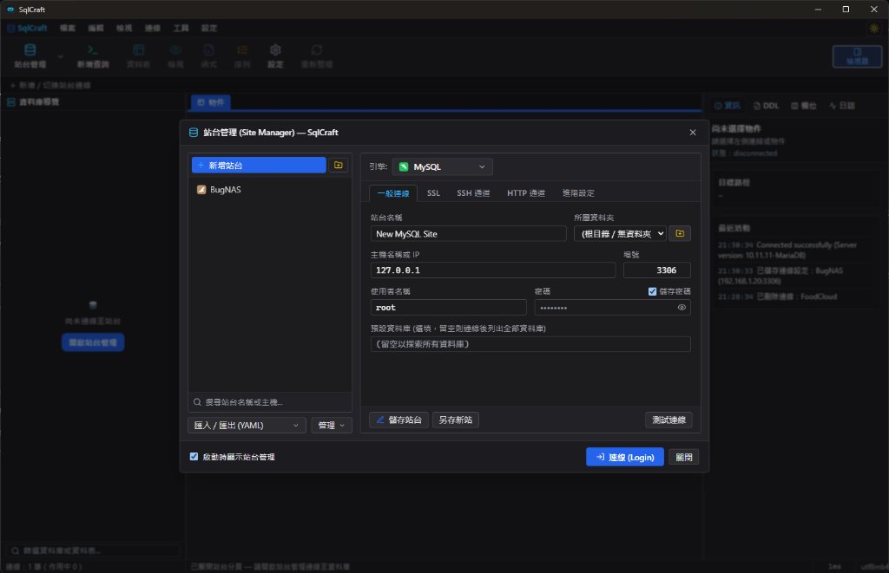
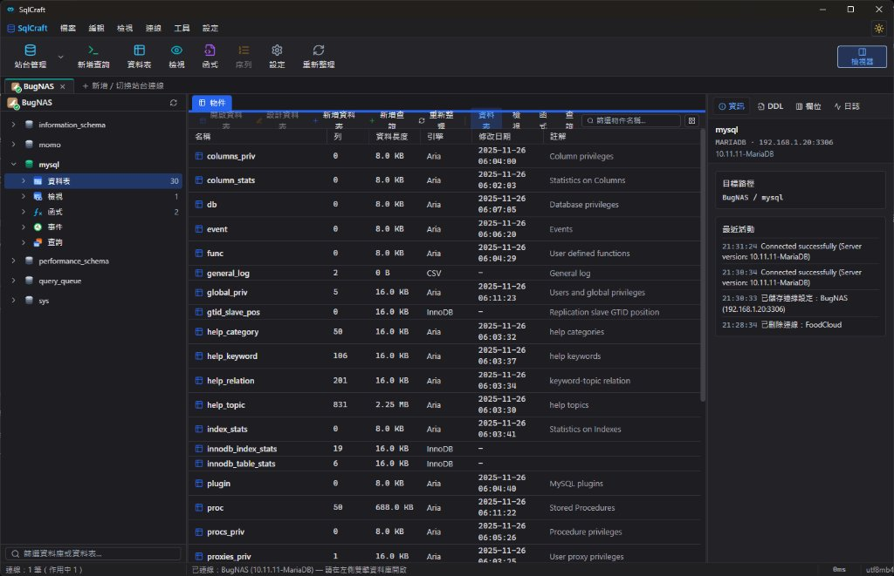

# SqlCraft

[English](README.md) | **繁體中文**

使用 **Tauri 2.0**（Rust + React + TypeScript + Monaco Editor）打造的跨平台資料庫管理工作台，支援 **MySQL**、**MariaDB** 與 **PostgreSQL**。

## 畫面預覽

### 站台管理 (Site Manager)


### 資料庫主工作台


## 核心功能

- **統一多資料庫 Rust 核心引擎 (`src-tauri/src/`)**：
  - 採用非同步 `sqlx` 連線池（MySQL / MariaDB 共用 `MySqlDriver`、`PostgresDriver` 支援多資料庫 `PgPool` 快取），內建 `rustls` SSL/TLS（`disable`、`prefer`、`require`、`verify_ca`、`verify_full`）與 `CancellationToken` 查詢取消控制。
  - 本機 SQLite 持久化 (`ProfileStore`) 搭配 **AES-256-GCM** (`CredentialCipher`) 加密儲存連線密碼與 SSH 密碼，並支援 `SavedQuery` 查詢儲存 CRUD。
  - 內建跨平台 SSH 埠轉發通道管理 (`SshTunnelManager`) 與相容 Navicat HTTP Tunnel 二進位封包編解碼 (`HttpTunnelPacketCodec`)。
- **經典工作台介面 (`src/`)**：
  - Navicat 風格多窗格佈局（`ConnectionTree`、`ObjectListPane`、`WorkspaceTabs`、`RightInspectorPane`），支援可拖曳寬度分隔線、深淺色主題切換與繁體中文／英文多語系。
  - 重新設計的站台管理員 (`ConnectionModal`) 與多分頁連線列 (`SessionTabsBar`)，支援資料夾分類、YAML 匯入／匯出、測試連線與免自動存檔的臨時連線。
- **虛擬化資料網格與視覺化資料表設計器**：
  - `@tanstack/react-virtual` 虛擬化資料網格 (`DataViewerGrid`)，支援視覺化篩選器 (`Filter Builder`)、多欄位排序、內聯編輯 Change Set（`INSERT` / `UPDATE` / `DELETE` SQL 預覽）與單一交易送出／放棄。
  - 6 分頁視覺化設計器 (`TableDesigner`：欄位、索引、外鍵、觸發器、選項、SQL 預覽），支援新建 `CREATE TABLE` 與修改 `ALTER TABLE`。
- **離線 Monaco SQL 編輯器與匯出精靈**：
  - 本機打包 `monaco-editor` Web Worker，支援依方言切換語法高亮（`mysql` / `pgsql`）、Schema-aware 智慧自動補全、`Ctrl+Enter` 執行選取／當前語句、`Ctrl+Shift+F` SQL 美化、多結果集 `結果 1..N` 分頁、逐句執行訊息與 `EXPLAIN` 計畫警示。
  - 支援將資料表或查詢結果透過 `ExportModal` 匯出為 **CSV**、**JSON** 或 **SQL `INSERT`** 腳本。

## 跨平台建置前置需求

### 共同需求
- **Node.js** `>= 20` 與 `npm`
- **Rust** stable 工具鏈 (`rustup`)

### Windows
- Visual Studio 2022 Build Tools（使用 C++ 的桌面開發 / `vcvars64.bat`）
- Microsoft Edge WebView2 Runtime（Windows 10 / 11 內建）

### Linux (Ubuntu / Debian)
```bash
sudo apt-get update
sudo apt-get install -y \
  libwebkit2gtk-4.1-dev \
  libappindicator3-dev \
  librsvg2-dev \
  patchelf \
  libssl-dev \
  build-essential
```

### macOS
- Xcode Command Line Tools (`xcode-select --install`)
- 如需編譯 Universal 雙架構可額外安裝：
  `rustup target add aarch64-apple-darwin x86_64-apple-darwin`

## 開發與建置指令

```bash
# 安裝前端相依套件
npm install

# 僅啟動前端網頁預覽
npm run dev

# 建置前端 (TypeScript 型別檢查 + Vite 打包)
npm run build

# 執行 Rust 後端單元測試（Windows 需先載入 VS 2022 Developer Command Prompt / vcvars64.bat）
cd src-tauri && cargo test

# 啟動完整 Tauri 2.0 桌面開發視窗
npm run tauri dev

# 建置正式版安裝檔 (.msi/.exe, .deb/.AppImage, .dmg/.app)
npm run tauri build

# 建置 Windows Portable 可攜版執行檔（設定檔存於 ./config/）
npx tauri build --no-bundle -- --features portable
```

## Windows Portable 可攜模式

SqlCraft 在以下任一情況會自動以 **Portable 模式** 運作：
- 使用 `--features portable` 編譯（例如 Release 中的 `SqlCraft_<version>_x64-portable.zip`），**或**
- 在 `SqlCraft.exe` 同層目錄存在 `config/` 資料夾、`.portable` 或 `portable.txt` 標記檔。

在 Portable 模式下，所有應用程式設定 (`config.json`)、加密後的站台管理與已儲存查詢 (`sqlcraft.db`) 以及 AES-256-GCM 金鑰 (`master.key`) 皆會統一保存於執行檔同層的 `<exe_dir>/config/` 資料夾中。

## 相關文件

- 版本更新紀錄：[CHANGELOG.md](CHANGELOG.md)
- 分階段開發路線與紀錄：[craft.md](craft.md)
- UI/UX 與驅動規格快照：[docs/navicat-ui-spec.md](docs/navicat-ui-spec.md)
- Navicat 對照驗證報告：[docs/parity-verification-report.md](docs/parity-verification-report.md)

## 授權條款

本專案採用 [Apache License 2.0 + Commons Clause 1.0](LICENSE) 授權。
